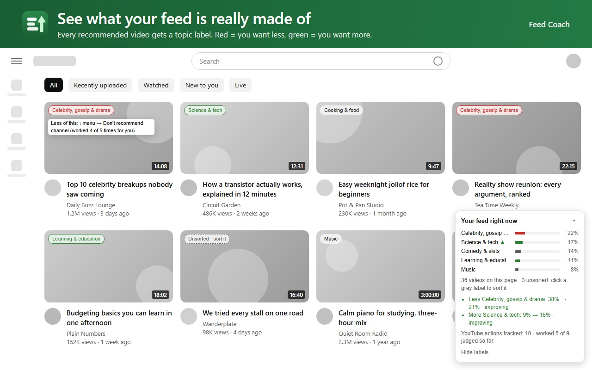

# Feed Coach

**Steer your YouTube homepage toward what you want, and see which of YouTube's own buttons actually work for you.**

Feed Coach is a free, open-source Chrome extension. It doesn't replace YouTube or hide anything. It helps you use the controls YouTube already gives you, and then measures whether they made a difference. Everything it records stays on your own computer.



## Why

Most of us have opened YouTube for one thing and found a homepage full of something else. YouTube does have buttons for this, like "Not interested" and "Don't recommend channel", but it's hard to tell whether they do anything. A [2022 Mozilla study, "Does This Button Work?"](https://www.mozillafoundation.org/blog/mozilla-investigation-youtubes-dislike-button-other-user-controls-largely-fail-to-stop-unwanted-recommendations/), found they only partly work on average: according to that study, "Don't recommend channel" cut similar unwanted recommendations by about 43%, and "Not interested" by about 11%.

Averages don't tell you what happens on *your* feed. Feed Coach does:

1. **It shows what your homepage is made of**, sorted into everyday topics.
2. **You pick goals**: more of some topics, less of others.
3. **It points at the videos working against your goals** and suggests which YouTube button to use. You click the button yourself.
4. **It measures what happened**: whether your goal topics are moving, and whether each button you used actually made that video or channel go away.

It's a coach for the platform you already use, not a new platform.

## Features

- **Your feed at a glance.** A small panel on the YouTube homepage shows the topic mix of what you're being recommended right now. Every video gets a small topic label.
- **18 everyday topics, plus your own.** Music, Gaming, Sports & football, Comedy & skits, Celebrity, gossip & drama, News & politics, Learning & education, Science & tech, Cooking & food, and more. Add your own topics with your own keywords.
- **Goals.** Click the Feed Coach icon and tap a topic once for *more*, twice for *less*.
- **Suggestions.** Videos in a "less" topic get a red label with a tip ("⋮ menu → Don't recommend channel"). Videos in a "more" topic get a green one.
- **Progress.** After a few days of normal use, you see "before → now" for each goal: improving, no real change yet, or going the wrong way.
- **"What worked for you."** When you use YouTube's "Not interested" or "Don't recommend channel" on a homepage video, Feed Coach notices and checks over the next two weeks whether it worked. Once a button has enough results, the tips use *your* numbers instead of the general advice.
- **Corrections that stick.** Click any label to fix its topic, for one video or the whole channel. Your corrections become rules that are tested so later rules can't quietly undo them.
- **It asks when it doesn't know.** Instead of guessing, the popup lists the channels it couldn't sort that appear most often, so one answer sorts a lot of videos.
- **Optional AI sorting.** If you want better sorting, you can connect your own free API key from Google Gemini, Groq or OpenRouter. It's off by default.

## Privacy in short

- Everything Feed Coach records is stored **on your computer**, in Chrome's local extension storage. There is no Feed Coach server, no account, no analytics and no tracking.
- It only runs on `www.youtube.com`, and it only **reads** the page. It never clicks, likes, subscribes or changes anything on YouTube for you.
- You can **export** everything as a file or **delete** everything from the settings page. Uninstalling the extension deletes it too.
- If, and only if, you turn on optional AI sorting, the **titles** of videos Feed Coach couldn't sort are sent straight from your browser to the AI provider you chose, using your own key. No channel names, times or account details are sent.

The full policy is in [PRIVACY.md](PRIVACY.md) and online at <https://olaoluwa99.github.io/feed-coach/privacy>.

## Install

### Chrome Web Store

Coming soon.

### Install the test version now

1. Go to the [Releases page](https://github.com/Olaoluwa99/feed-coach/releases) and download the latest `feed-coach-<version>.zip`.
2. Unzip it somewhere you'll keep it (Chrome loads the extension from that folder, so don't delete it).
3. Open `chrome://extensions` in Chrome.
4. Turn on **Developer mode** (top right).
5. Click **Load unpacked** and choose the unzipped folder (the one that contains `manifest.json`).
6. Open [youtube.com](https://www.youtube.com). The Feed Coach icon shows a green **ON** badge. If you don't see the icon, pin it from the puzzle-piece menu.

To update, download the new zip, replace the folder's contents, and click the reload icon on Feed Coach's card in `chrome://extensions`. Your data is kept.

### What you need

- **Desktop Chrome** (or another Chromium browser that supports Chrome extensions). Chrome on phones doesn't support extensions.
- **YouTube watch history turned on.** With history off, YouTube shows no recommendations on the homepage, so there's nothing to coach. The popup tells you if this is the case.

## Using it

1. Open the YouTube homepage and wait a few seconds. Labels and the panel appear.
2. Click the Feed Coach icon and set a goal or two.
3. Use YouTube as normal. When you see a red label, open the video's ⋮ menu and use the suggested button if you agree.
4. Check the popup every few days: **Progress** shows how your goals are going, and **What worked for you** shows how each button did.
5. If a label is wrong, click it and pick the right topic.

The settings page (popup → **Settings & your data**) has your topics, your rules, your tracked YouTube actions, optional AI, and export and delete.

## How it works

The design reasoning is written up in [docs/design.md](docs/design.md). In short:

### Reading the homepage

When you open the YouTube homepage, Feed Coach waits for the recommendations to load and then saves a **snapshot**: up to 40 videos with their video ID, title, channel name and position on the page, plus the time. Ads are skipped (only counted). It takes at most one snapshot every 5 minutes and keeps the latest 500.

Topics are **not** stored in snapshots. They're worked out fresh every time, so fixing a label also fixes the past.

### Sorting videos into topics

Each video is checked in this order, and the first answer wins:

1. **Your rules.** "This video is X", "this channel is X", or "titles containing Y are X". Video rules beat channel rules, which beat keyword rules; among keyword rules, the newest wins.
2. **Optional AI**, if you turned it on. Each answer is remembered per video.
3. **Built-in keywords** for the 18 topics, plus the keywords of any topics you added. A match in the title counts double compared to one in the channel name. A tie between topics counts as unsorted.
4. **Ask you.** Anything still unsorted is grouped by channel, and the popup asks about the ones that showed up most in the last 7 days.

### Tested rules

Every label you give by hand is kept as an **example**, and examples act as tests. Before a new rule is saved, every earlier example is re-checked. If the new rule would change one of them (say, a new channel rule would re-sort a video you'd labelled differently), that earlier label is kept as a video-level **exception**, and you're told. Your earlier corrections never change silently. When you remove a rule, any labels that only that rule kept correct are removed too, so the rest still pass.

### Progress toward goals

- **Before** is your homepage's average share of that topic in the 7 days before you set the goal. If there's no data from then (for example, you set the goal on the day you installed), the first day of snapshots after the goal is used instead.
- **Now** is the average share over the last 7 days, not counting whatever was used as "before".
- A verdict needs at least 3 snapshots after the goal, reaching at least 2 days past it. Until then it says "measuring".
- A change of less than 2 percentage points counts as "no real change".

### Tracking YouTube's buttons

Feed Coach watches your clicks on homepage videos. When you open a video's ⋮ menu and choose **Not interested** or **Don't recommend channel**, it records the action. If you click **Undo** inside that same video card within 2 minutes, the action is cancelled. Menu labels are recognised in English, French, Spanish, Portuguese, German and Italian. If a click is missed, you can report it from the label's menu ("Already used YouTube's ⋮ menu on this?"), and you can remove wrong entries in the settings.

Each action is judged from your snapshots:

- **Before:** the share of homepage visits showing that channel in the 7 days before the action, including the visit where you clicked. This is fixed at the moment the action is recorded. Comparisons need at least 3 earlier visits.
- **After:** the share of visits showing the channel in the 2 weeks after. Snapshots within 5 minutes of the action count as the same visit.
- A result needs at least 5 later visits reaching at least 2 days past the action. Until then it's "measuring".
- When the 2 weeks are up, the verdict is **frozen**. If there weren't enough visits by then, it's "not enough visits to judge".

| Button | Worked | Partly | Didn't work |
|---|---|---|---|
| Don't recommend channel | The channel never appears again | It appears half as often as before, or less | Otherwise |
| Not interested | The video is gone, and its channel appears half as often or less (or not at all) | The video is gone, but the channel still shows up as much | The same video came back |

If YouTube didn't show a channel name (some Shorts), "Don't recommend channel" can't be checked, and "Not interested" is judged by the video alone.

Once a button has at least 3 judged results, the tip on "less" videos recommends whichever button has worked best for you, with your own numbers.

## Limitations

Honest ones:

- **YouTube changes its page often.** When it does, labels, snapshots or click detection can stop working until Feed Coach is updated. Old data stays safe.
- **Keyword sorting is rough at first**, especially for titles that aren't in English. A few channel corrections go a long way, because the same channels repeat a lot.
- **Results are hints, not proof.** A channel might disappear because it stopped posting, not because of the button. "Not interested" is meant to reduce *similar* videos, which Feed Coach can only approximate by channel. With only a few actions, treat the numbers as a rough guide.
- **Only the homepage is measured**, not search, the sidebar, Shorts feed or subscriptions.
- **Desktop Chrome only**, and it needs YouTube watch history on. Since recommendations belong to your Google account, steering on desktop probably affects your phone and TV feed too, but Feed Coach can't measure those.
- **One browser profile.** Data isn't synced between computers.
- Click detection only knows the menu labels in the six languages above. In other languages, use the hand report.
- Changing a feed takes time, and YouTube's buttons have limits of their own. Feed Coach shows you what's happening; it can't force YouTube to listen.

## Development

Needs Node.js 22 or newer.

```bash
npm install
npm run build      # bundles src/ and static/ into dist/
npm run watch      # rebuilds on every change
npm test           # runs the tests (Vitest)
npm run typecheck  # checks types (TypeScript)
npm run package    # builds and creates release/feed-coach-<version>.zip
```

To try your build, load the `dist/` folder with **Load unpacked** in `chrome://extensions` (Developer mode on). After rebuilding, click the reload icon on the extension's card and refresh the YouTube tab.

The zip from `npm run package` is what gets uploaded to the Chrome Web Store and attached to GitHub Releases for testers.

### Project layout

| Path | What it is |
|---|---|
| `static/` | Files copied as they are: `manifest.json`, `popup.html`, `options.html`, `shared.css`, `icons/` |
| `src/content.ts` | Runs on YouTube: takes snapshots, draws labels and the panel |
| `src/youtube/homepage.ts` | Reads videos from YouTube's page markup (the part most likely to break when YouTube changes) |
| `src/youtube/feedback.ts` | Notices your clicks on "Not interested" / "Don't recommend channel" / "Undo" (it only watches) |
| `src/ui/overlay.ts` | The on-page labels and panel (shadow DOM, no HTML strings, because YouTube enforces Trusted Types) |
| `src/core/` | Pure logic with no browser APIs: topics, sorting, rules, stats, action tracking, AI request and reply parsing. Most tests live here. |
| `src/background.ts` | Service worker; the only part that writes stored data |
| `src/storage.ts` | Reads and writes `chrome.storage.local` |
| `src/popup.ts` | The popup: goals, progress, what worked, topic mix, "help me sort these" |
| `src/options.ts` | The settings page: topics, rules, tracked actions, AI, export and delete |
| `src/messages.ts` | Message types shared between the parts |
| `build.mjs` | Bundles `src/` with esbuild into `dist/` |
| `store/` | Chrome Web Store listing text and images |
| `docs/` | The GitHub Pages site: privacy policy and design notes |

### If YouTube changes its layout

Snapshots and labels stop appearing (the popup keeps showing old data). Open the YouTube homepage, inspect a video card, and update the selectors in `src/youtube/homepage.ts` along with the sample markup in `src/youtube/homepage.test.ts`. Menu detection lives in `src/youtube/feedback.ts`, and the menu labels in `src/core/actions.ts`.

## Contributing

Issues and pull requests are welcome.

- **Found a bug, or YouTube changed something?** [Open an issue](https://github.com/Olaoluwa99/feed-coach/issues). Say what you expected, what happened, and your Chrome version. Please don't paste your exported data or API key.
- **Want to help?** Useful contributions include better keywords for the built-in topics (especially for languages other than English), YouTube menu labels in more languages, and fixes when YouTube's markup changes.
- **Before a pull request**, run `npm test` and `npm run typecheck`. Keep the privacy promise: no new data leaving the computer, no remote code, and no new permissions without a clear reason.

## License

[MIT](LICENSE). Copyright (c) 2026 Olaoluwa99.

Feed Coach is an independent project and isn't affiliated with or endorsed by YouTube or Google.
